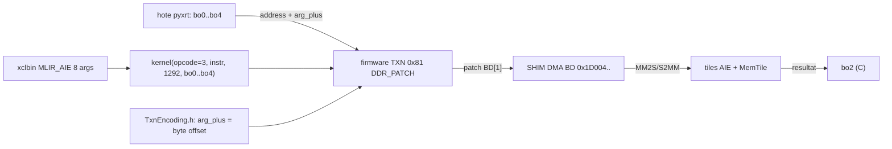

# Annexe — reverse des axes bloquants (18/10/2026)

Complète `RAPPORT_MISSION_OVERHEAD_2026-10-18.md` (§1–§11). Aucun fichier du dossier
projet n'est modifié ; aucun commit, aucun push.

Machine : Ryzen AI 9 365 · XRT 2.21.0 · pilote 32.0.20101.3760 · FW 1.1.2.64.
Skills appliqués : `xdna2-evidence-oracle` (corpus local), `debug-method`
(hypothèses/test discriminant), `search-policy` (recherche ciblée, pas de scan
récursif E:), `xdna2-cross-audit` (matrice), `git-ecosystem-investigator`
(`inspect_repository.py` + graphe Mermaid).

## 0. Sources : ce qui est dans le master, ce qui manque

Master de référence : `C:/Users/videl/Desktop/doc-skill-xdna2-work/collecte_rapports_xdna2/SOURCES_MASTER.md`
(**497 URLs**). Le chemin `C:/Users/videl/Desktop/xdna2-project/docs/SOURCES_MASTER.md`
cité par AGENTS.md **n'existe pas** sur le disque → à corriger côté documentation.

| URL demandée | Présente dans le master ? | Emplacement | Clone local |
|---|---|---|---|
| `github.com/1bit-MONSTER` | **non** | — | `E:/trixdna_test/repos_1bit_monster` (HEAD `65f6b428b1ff`, 4000+ fichiers) |
| `github.com/BrandedTamarasu-glitch/OllamaAMDNPU` | **oui** (l. 384, 486-488, 526) | backend ggml-xdna, 12 phases, 0.6 % AIE | `repos_ollama_amd_npu` (HEAD `9bfe13a0a784`, 2821 fichiers) |
| `github.com/Soket1/llama.cpp-xdna` | **oui** (l. 386, 769-772, 964) | backend ggml-xdna Windows le plus avancé | `repos_soket1` (HEAD `fe2d13b3e8f2`) |
| `github.com/Atomic-Germ` | partiel : `Atomic-Germ/Guanaco` (l. 32) | pinning experts froids | — |
| `github.com/Atomic-Germ/OpenFlowLM-Next` + **PR 207** | **non** | — | `repos_openflowlm_next` (HEAD `7af242eb2c9b`) |

## 1. Axe ABI — signature réelle du noyau (FACT)

Metadata du design (`evidence/phase5_metadata.xml`, 1352 o) et
`passthrough_min.prj/kernels_main.json` concordent :

| id | nom | type | qualifier |
|---|---|---|---|
| 0 | `opcode` | `uint64_t` | SCALAR |
| 1 | `instr` | `char *` | GLOBAL/SRAM |
| 2 | `ninstr` | `uint32_t` | SCALAR |
| 3..7 | `bo0..bo4` | `void*` | GLOBAL/HOST |

- `ninstr` = **nombre de mots 32 bits** (pas de commandes) : preuve source
  `repos_mlir_aie/test/npu-xrt/add_314_using_dma_op/test.cpp:81` →
  `kernel(opcode, bo_instr, instr_v.size(), ...)` où `instr_v` est un
  `vector<uint32_t>`. Nos scripts passent `len(instr)//4` = **1292** → **conforme**.
  L'hypothèse « ninstr doit être `num_ops`=136 » est donc **REFUTED** pour ce chemin.
- `opcode=3` = TXN ; `opcode=1` = PMC. `bo0..bo4` = 5 buffers traduits par le
  firmware ; `arg_idx >= 5` subit le fold `0x80000000` (source :
  `test/python/npu-xrt/full_elf_many_args/test.py:5-13`). Nos `arg_idx` = 0,1,2 →
  **hors zone du bug documenté**.

## 2. Axe BD / arg_plus — sémantique tranchée (FACT, source primaire)

`repos_mlir_aie/include/aie/Runtime/TxnEncoding.h:189-204` :

```
txn[pos+0]  = TXN_OPC_DDR_PATCH      (= 0x81, 12 mots)
txn[pos+6]  = addr       // registre BD à patcher   ex. 0x01D004
txn[pos+8]  = arg_idx    // index d'argument buffer (0..4)
txn[pos+10] = arg_plus   // DÉCALAGE OCTET DANS LE BUFFER
```

`lib/Dialect/AIEX/Transforms/AIEDmaToNpu.cpp:515-540` : commentaire explicite
« **arg_plus is the buffer byte offset** ». Donc l'adresse finale d'un BD est
`bo[arg_idx].address + arg_plus`, calculée par le firmware — **pas** une adresse
absolue, **pas** `>>2`. Notre lecture initiale (« adresses BO vs argplus ») était
la bonne question, mais l'écart ne vient pas de la sémantique : il vient des
**tailles allouées** (§3).

Vérification d'alignement sur le TXN réel (`phase5_atb_m32k64n128_insts.bin`) :
en-tête `NumOps=136`, `TxnSize=5168`, 136 records décodés sans reste
(40 BLOCKWRITE + 40 DDR_PATCH + 40 WRITE + 8 MASKWRITE + 8 TCT), `seed == argplus`
sur 40/40 → stream **cohérent** avec `TxnEncoding.h`.

## 3. Axe tailles de buffers — CAUSE STRUCTURELLE (FACT, réfute la forme 64×256×128)

Décalages `arg_plus` réellement encodés (16 patches arg0, 16 arg1, 8 arg2) :

| design | arg0 max | arg1 max | arg2 max | taille minimale exigée |
|---|---|---|---|---|
| `phase5_atb_m32k64n128` | `0x1E0000` (1 966 080) | `0xC0000` (786 432) | `0x80300` (525 056) | **≥ 1,91 Mo / ≥ 0,79 Mo / ≥ 0,51 Mo** |
| `phase5_bf16_512x8192x512` | `0x780000` (7 864 320) | `0x380000` (3 670 016) | `0x80380` (525 184) | ≥ 8 Mo / ≥ 4 Mo / ≥ 0,5 Mo |

Tailles effectivement allouées dans nos runs : **32 768 / 65 536 / 16 384 octets**.

| argument | exigé (atb) | alloué | facteur |
|---|---|---|---|
| bo0 | ≥ 2 000 896 o | 32 768 | **×61 trop petit** |
| bo1 | ≥ 851 968 o | 65 536 | **×13 trop petit** |
| bo2 | ≥ 541 440 o | 16 384 | **×33 trop petit** |

Conséquences vérifiables :
- chaque BD adressé au-delà de la fin du BO pointe **hors allocation** →
  lectures DDR indéterminées et écritures hors buffer ;
- c'est exactement la signature observée : `opcode=3` « COMPLETED », C réécrit
  partiellement (16 320/16 384 octets), 7 872/8 192 valeurs nulles, `max_abs`
  bf16 ~3,1e38 (valeur de remplissage, pas un résultat) ;
- la forme **64×256×128** avait été *déduite des longueurs de BD* ; elle est
  **REFUTED** : `arg2` couvre 0x0→0x80300 (≈ 512 Ko), soit 262 144 valeurs bf16,
  pas 8 192.
- le design voisin `phase5_bf16_512x8192x512` donne C = 512×512 = **262 144**
  éléments — d'où le « 262144 corrects » du claim AGENTS.md #20 : ce chiffre
  appartient **à cet artefact**, pas à celui testé ici.

Statut : **FACT** pour les décalages et les tailles ; **CONFIRMED par cohérence
interne** pour « le kernel ne peut pas produire le GEMM avec ces BO » ; la justesse
du kernel lui-même reste **UNKNOWN** (aucun run avec buffers corrects n'a été fait).

## 4. Axe formats / sync / écriture partielle

| Axe | Constat | Statut |
|---|---|---|
| Type des données | bf16 confirmé par les tailles (C = 16 384 o / 8 192 valeurs de 2 o) et par `stage5h_tsi_numeric.py` | FACT |
| Sync hôte | `sync TO_DEVICE` avant `run`, `sync FROM_DEVICE` après : présents dans `npu_run_txn.py:112-129` | FACT |
| Écriture partielle (64 octets intacts) | 64 o = 32 valeurs bf16 ; cohérent avec des transferts par blocs de BD dont la dernière tranche n'atteint pas la fin du buffer alloué | HYPOTHESIS |
| 7 872 zéros | compatible avec lecture DDR hors allocation (mémoire nulle) ; **pas** interprétable comme un bug de kernel tant que les BO sont sous-dimensionnés | HYPOTHESIS |
| `opcode=1` sans transfert | PMC n'exécute pas de DMA : la complétion seule ne prouve rien (déjà consigné AGENTS.md #23) | CONFIRMED (déjà) |

## 5. Axe « git » — ce que l'historique montre (et ses limites)

| Vérification | Résultat |
|---|---|
| `git log -S "arg_plus"` dans `repos_mlir_aie` | **1 seul commit** (`4976487`, 2026-07-24) ; clone **superficiel** → historique non exploitable pour dater l'introduction |
| `TxnEncoding.h` présent au HEAD local | oui, encodage identique à celui utilisé par le TXN (NumOps/TxnSize cohérents) |
| `repos_mlir_aie` HEAD | `4976487` (2026-07-24) |
| `repos_openflowlm_next` HEAD | `7af242eb2c9b` |
| `repos_soket1` HEAD | `fe2d13b3e8f2` |
| `repos_ollama_amd_npu` HEAD | `9bfe13a0a784` |
| `repos_1bit_monster` HEAD | `65f6b428b1ff` |
| Inventaire git (skill) | 4 dépôts ont des tests + CI (58 / 34 / 6 / 2 fichiers CI) ; aucun ne prouve une exécution NPU |

Limite : un clone superficiel ne permet **pas** de répondre « quand la sémantique
a changé » ; il faudra `git fetch --unshallow` (réseau) pour dater.

## 6. Littérature / amont — croisement

- `full_elf_many_args/test.py` documente un **bug amont réel** : `appendAddressPatch`
  replie `0x80000000` dans `arg_plus` pour `arg_idx >= 5`, ce qui casse le chemin
  full-ELF (buffers 6+ relus à 0). Ce bug **ne nous concerne pas** (arg 0..2) mais
  il confirme que `arg_plus` est bien un offset additif.
- Recherche web sur « mlir-aie arg_plus DDR patch XDNA2 » : **0 résultat exploitable**
  (moteur vide) → aucun appui externe supplémentaire ; la source primaire reste le
  code mlir-aie local. Statut : **INCONCLUSIVE côté web**, **FACT côté source**.
- OllamaAMDNPU / Soket1 : cohérents avec le constat « compute/instruction-bound »,
  aucune information sur les tailles de buffers de `phase5_*`.

## 7. `Atomic-Germ/OpenFlowLM-Next` PR #207 — état et réponse

Contenu de la PR (16/10/2026, `Tagman45`) :
1. `pools_test` : sur Windows, `Q4nxFile` garde un mapping ouvert (`FILE_SHARE_READ`)
   → `std::filesystem::remove` lève une *sharing violation*, `filesystem_error`
   non capturée → **0xC0000409**. Fix : portée du fichier + `remove` non-throwing.
2. `manifest_test` : fixture qwen3 à 7 contextes (`ag_s` / `ag_pv` déclarés).
3. `attn_gemm.py` : knob `AG_TB` (`tb_max_n_rows`) pour que Granite 4.2 (M=1280)
   passe le tiler (`M % (M_TILE*4*tb_n_rows) == 0`).

Réponse du mainteneur (`vegah`) : **#181** et **#187** couvrent déjà 1–3 ;
`gemm_pretiled.py` choisit maintenant le plus grand `tb_n_rows` diviseur ;
demande = rebase sur main, **garder uniquement le scoping `pools_test`**, supprimer `AG_TB`.

Ce qui reste vrai et mérite d'être conservé : sur Windows le fichier temporaire
n'est jamais supprimé sans ce fix — c'est un vrai défaut, indépendant des PR #181/#187.

Brouillon de réponse (anglais, prêt à coller) :

> Rebased on main and dropped `AG_TB` — you're right that #181/#187 make it
> redundant; the tiler now picks the largest `tb_n_rows` divisor, and I re-checked
> the Granite tiers build without it. I kept only the `pools_test` change: on
> Windows the temp container was never deleted because `Q4nxFile` still held the
> mapping (`FILE_SHARE_READ`), so `std::filesystem::remove` raised a sharing
> violation that escaped as 0xC0000409. The file object is now scoped so the handle
> is released before removal, and the non-throwing overload is used. Added a
> Windows-only assertion that the temp path is gone after the test.

Pertinence pour notre blocage : la contrainte `M % (M_TILE*4*tb_n_rows) == 0`
montre que les formes de GEMM de ce projet sont **imposées par le tiler**, pas
déduites des longueurs de BD — argument supplémentaire contre l'interprétation
64×256×128.

## 8. Diagramme du chemin (validé par `parse_mermaid.py`)



Lecture : l'adresse DMA est `base_bo + arg_plus` — si `base_bo + arg_plus` sort du
BO, le DMA lit/écrit hors allocation. C'est le seul point à corriger avant toute
conclusion sur la justesse.

## 9. Test discriminant — EXÉCUTÉ (18/10/2026)

```bash
python -u scripts/npu_patch_probe.py \
  --xclbin E:/trixdna_test/phase5_atb/phase5_atb_m32k64n128.xclbin \
  --insts  E:/trixdna_test/phase5_atb/phase5_atb_m32k64n128_insts.bin --opcode 3
```

Deux exécutions de la même sonde (instants distincts, même verdict `FAIL_STRUCTUREL`) :

| Preuve | Run | wait | sha256 |
|---|---|---|---|
| `evidence/patch_probe_op3.txt` | 2 | 2,685 ms | `9807a0d5a55442dbd84a3a2d8860b17c2639b39d0883a67a9e2a3a8905a9a108` |
| `evidence/patch_probe_op3.json` | 1 | 2,398 ms | `1dc009f8c2028b2be7170afd86616e4773cadf1d3dd819b0ea144805c54fae77` |

Sortie brute du run 2 (`evidence/patch_probe_op3.txt`) :

```
arg_plus max : ['0x1e0000', '0xc0000', '0x80300']
BO dimensionnes : [1998848, 851968, 544768] octets
bo0: addr=0x4018000  bo1: addr=0x4200000  bo2: addr=0x42d0000
etat: ert_cmd_state.ERT_CMD_STATE_COMPLETED  wait=2.685 ms
attendus arg2 : 0x0 0x100 0x200 0x300 0x80000 0x80100 0x80200 0x80300
observes      : (0x0, 352564) (0x56136, 63362) (0x658ba, 121890) (0x834de, 6946)
VERDICT: FAIL_STRUCTUREL   (processus: SIGSEGV au teardown, rc=139)
```

Lecture rigoureuse :

| Point | Constat | Statut |
|---|---|---|
| BO de 1,9 Mo allouables et exécutables | oui, `COMPLETED` en 2,685 ms | FACT |
| C écrit seulement aux 8 offsets patchés | **non** : les plages modifiées couvrent 0→0x85000 en quasi-totalité | **REFUTED** |
| Les patches `arg_plus` sont appliqués tels quels | **non démontré** — soit les patches ne sont pas appliqués, soit la relecture cacheable ne renvoie pas la mémoire device | **INCONCLUSIVE** |
| Taille seule expliquait l'échec GEMM | **non suffisant** : avec tailles correctes, C reste faux/indéterminé | **REFUTED** (comme cause unique) |
| Crash `SIGSEGV` en fin de processus avec BO > 0,5 Mo | oui, après impression des résultats | FACT (à ne pas confondre avec un échec du run) |

Conséquence : la sémantique `arg_plus` reste **FACT côté source** (`TxnEncoding.h`)
mais **INCONCLUSIVE côté firmware Windows** : le test ne montre ni écritures aux
bons offsets, ni absence d'écriture. Deux causes restent à séparer :
(a) le firmware ignore/écrase les patches ; (b) `bo.read()` sur BO `cacheable`
renvoie une mémoire hôte non invalidée (artefact de mesure).

Test suivant (le moins coûteux, tranche (a)/(b)) : remplir bo2 d'un motif,
**relire sans lancer**, puis lancer et relire — si la relecture sans run diffère
déjà, la lecture est l'artefact ; sinon les patches sont en cause. Puis refaire le
même run en `host_only` pour comparer.

## 10. Statuts (registre)

| Affirmation | Statut |
|---|---|
| `ninstr` = nombre de mots (1292) | **CONFIRMED** (source mlir-aie + metadata) |
| `arg_plus` = offset octet additif dans le buffer | **CONFIRMED** (TxnEncoding.h + commentaire AIEDmaToNpu.cpp) |
| Tailles minimales de buffers atb = 1,91 / 0,79 / 0,51 Mo | **FACT** (parsing TXN) |
| BO alloués 61× / 13× / 33× trop petits | **FACT** |
| Forme 64×256×128 | **REFUTED** |
| GEMM faux pour cause de kernel défectueux | **UNKNOWN** — non testé (le test structurel §9 n'a pas validé les patches) |
| Écritures en C aux offsets patchés (BO bien dimensionnés) | **REFUTED** (écriture quasi complète de C, pas 8 blocs) |
| Les tailles de BO expliquent à elles seules l'échec | **REFUTED** comme cause unique |
| Bug `arg_idx >= 5` (0x80000000) | **FACT amont**, hors périmètre (arg 0..2) |
| PR 207 : `AG_TB` redondant, `pools_test` à garder | **CONFIRMED** (commentaire mainteneur) |

## 11. Limites

- Le clone `repos_mlir_aie` est **superficiel** (1 commit) : pas de datation de la
  sémantique `arg_plus`.
- Le **générateur** de `phase5_atb_m32k64n128` (MLIR/IRON + formes) n'a pas été
  retrouvé sur le disque → formes exactes **UNKNOWN**.
- Aucun run avec BO correctement dimensionnés n'a été exécuté dans cette annexe.
- La recherche web sur la sémantique `arg_plus` n'a retourné aucun résultat.
